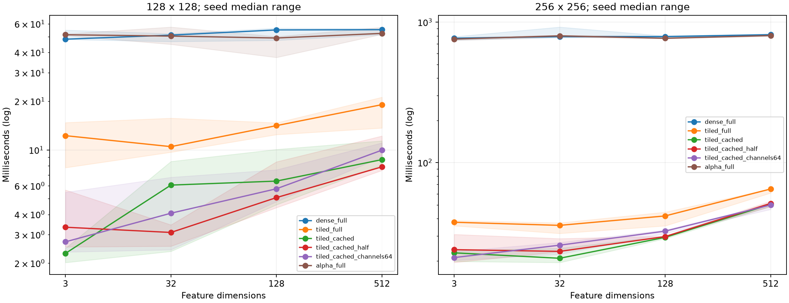
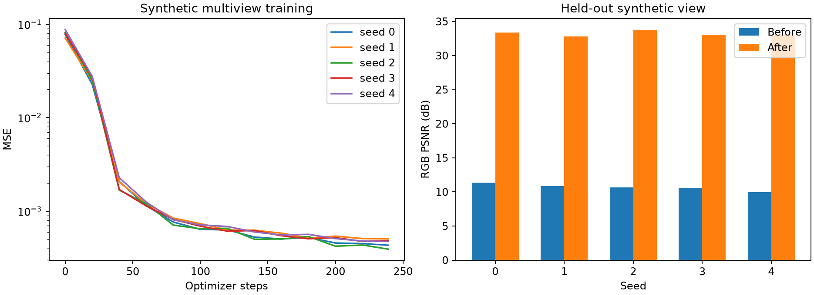
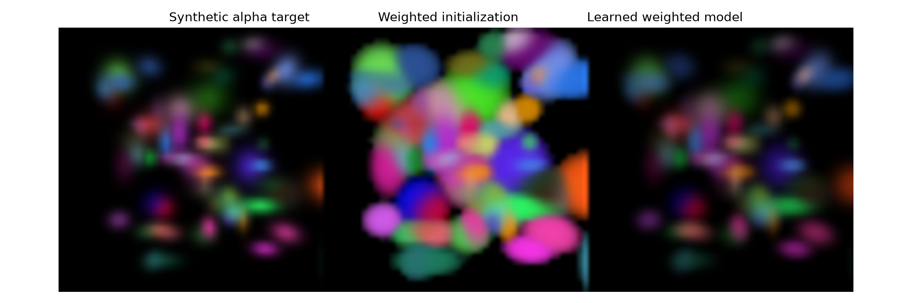

<div align="center">

<h1>MatrixSplat: Matrix-Parallel and Feature-Scalable 3D Gaussian Splatting Rendering on GPUs [Reproduction]</h1>

<p><strong>Matrix rendering · Feature scalability · Apple GPU experiments</strong></p>

<p>Independent implementation · Reproducible evidence · Transparent limitations</p>

<p>
<a href="https://arxiv.org/abs/2611.15153"></a>


<a href="https://github.com/gulucaptain/MatrixSplat-Reproduction/actions/workflows/tests.yml"></a>
<a href="LICENSE"></a>
</p>

<p><a href="https://arxiv.org/abs/2611.15153">📄 Paper</a> · <a href="results/round05/REPORT.md">📊 Results</a> · <a href="COVERAGE.md">🔍 Coverage</a> · <a href="ITERATIONS.md">🧪 Iterations</a></p>

</div>

## 🎯 Reproduction at a glance

| | Scope & evidence |
|:--|:--|
| 🧩 **Implemented** | Weighted matrix rendering, tiled accumulation, channel slicing and differentiable projection. |
| 🧪 **Validated locally** | Five local cycles · five training seeds · 144 final GPU benchmark configurations. |
| 🔎 **Remaining gaps** | No NVIDIA kernel, official datasets or paper-equivalent speed comparisons. |

> [!IMPORTANT]
> This is an independent, partial reproduction—not the authors’ official implementation. Local experiments do not establish full paper-result reproduction.

---

A reproducible local implementation of the weighted rendering formulation from **MatrixSplat: Matrix-Parallel and Feature-Scalable 3D Gaussian Splatting Rendering on GPUs**, with CPU validation and PyTorch MPS execution on Apple M4 Pro.

**Status: five local development/experiment cycles completed; the paper's NVIDIA kernel and benchmark tables are not reproduced.** This is not the authors' implementation. Local acceleration ratios compare our own implementations only.

## 🧩 Implemented

- Perspective projection of full 3D covariance, pixel Gaussian opacity and thresholding.
- Independent loop accumulation, dense weighted matrix accumulation and exact ordered-alpha tensor baseline.
- Pixel streaming, conservative tile culling, packed tile candidate lists, batched matrix rendering and channel slices.
- Optional half-precision matrix operands; differentiable FP32 projection/weights.
- Positive directional visibility, opacity, feature, scale and background optimization in a multiview synthetic training experiment.
- Standard 3DGS PLY geometry/DC-color importer (higher-order color SH emits a warning and is not supported).
- Finite-difference/analytic gradient tests, CPU FP64 reference comparisons, and synchronized MPS timings.

## ⚙️ Installation

Python 3.12 is required. Run the following commands from a fresh clone:

```sh
git clone https://github.com/gulucaptain/MatrixSplat-Reproduction.git
cd MatrixSplat-Reproduction
python3.12 -m venv .venv
source .venv/bin/activate
python -m pip install --upgrade pip
python -m pip install -e '.[dev]'
python -m pytest tests -q
python scripts/verify_results.py
```

For the recorded macOS environment, use `python -m pip install -c requirements-lock.txt -e '.[dev]'`. The lock records tested versions on this Mac; it is not a universal cross-platform lock.

## 🔁 Rebuild

```sh
.venv/bin/python -m matrixsplat.experiment --round 1 --device cpu
.venv/bin/python -m matrixsplat.gpu_experiment --round 2
.venv/bin/python -m matrixsplat.gpu_experiment --round 3
.venv/bin/python -m matrixsplat.train --seeds 5 --steps 240
.venv/bin/python -m matrixsplat.benchmark --seeds 3 --repeats 11
.venv/bin/python -m matrixsplat.report
```

Each command overwrites its corresponding result directory; copy a directory before rerunning if you want to retain it. No external dataset or model downloads are required for the synthetic suite. Seeds reconstruct the inputs. Historical source snapshots under `results/roundXX/source` preserve implementation differences; current commands use the final implementation.

## 🚀 Using a scene

```python
from matrixsplat.io import load_ply
from matrixsplat.render import Camera
from matrixsplat.tiled import render_tiled
means, cov, opacity, colors = load_ply('/absolute/path/point_cloud.ply', device='mps')
# Transform world means/covariances to camera coordinates before this call.
image = render_tiled(means, cov, opacity, colors, Camera(256, 256, 240))
```

Camera coordinates are +Z forward; pixel centers are half-integers; size and focal length are in pixels. A cached `TilePlan` is valid only for the geometry, view, opacity bound and cutoff used to construct it. Rebuild the plan after changing geometry or increasing opacity beyond its bound. Training uses fixed geometry and plans built with opacity=1 to conservatively cover all learned opacities.

## 📊 Results

On five synthetic training seeds, held-out RGB PSNR improves from 10.66 to 33.21 dB. The final 144 GPU benchmark configurations include 11 synchronized samples each. FP32 tile/dense maximum difference is 3.58e-7; half-matmul maximum difference is 0.00107. Local dense-to-tiled ratios describe this implementation only.

[Five iterations](ITERATIONS.md) · [Final report](results/round05/REPORT.md) · [Coverage and limitations](COVERAGE.md) · [Original-source manifest](sources/manifest.json)





The full-render measurements include projection, rasterization and blending; tiled full rendering additionally constructs the CPU candidate plan. Cached-plan measurements exclude this plan construction. They are not the paper's kernel-isolated timings. Raw samples, seeds, timing scopes, tensor allocation counters and source hashes are saved. Allocation counters are not peak memory estimates.

## 🔎 What is not reproduced

No CUDA warp MMA/ldmatrix implementation, no NVIDIA Tensor Core measurements, no official 3DGS/TC-GS/FlashGS integration, no Mip-NeRF360/LERF/3D-OVS training, no full geometry densification/pruning, and no original semantic benchmark results. The synthetic training experiment fixes geometry and optimizes appearance/blending; it must not be presented as full 3D reconstruction. Positive first-order directional visibility is a documented parameterization choice because the exact author's positivity convention is not established.

## 📄 Source

[Paper original](https://arxiv.org/html/2611.15153v1). See `sources/manifest.json` for retrieval date and SHA-256.

## ✅ Verification and license

`python scripts/verify_results.py` checks all five archived source snapshots against their recorded hashes and rebuilds the final numerical summaries from raw records. CPU tests and this verification run in GitHub Actions. MPS measurements require an Apple Silicon machine and are not rerun by Linux CI.

Original code is released under the [MIT License](LICENSE); see [NOTICE](NOTICE) and [software citation metadata](CITATION.cff). Cite the original paper linked above when using its method.

---

## 🧭 Reproduction collection

Independent research implementations with recorded configurations, experimental evidence and explicit limitations.

| Project | Focus |
|:--|:--|
| [Directional Stationarity](https://github.com/gulucaptain/Directional-Stationarity-Reproduction) | Nonsmooth optimization |
| [Quadratic Bézier Splatting](https://github.com/gulucaptain/Quadratic-Bezier-Splatting-Reproduction) | Stroke-based rendering |
| KoalaGS · local project; repository pending | Continuous Gaussian LoD |
| [PhySPRING](https://github.com/gulucaptain/PhySPRING-Reproduction) | Physics-informed graph reduction |
| **MatrixSplat** · this project | Matrix-based Gaussian rendering |
| [SimuScene](https://github.com/gulucaptain/SimuScene-Reproduction) | Scene geometry and physics |
